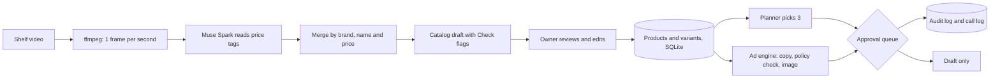

# Marketing Brain

Turns a short video of a shelf into a product catalog, then helps a small shop owner
promote its best products with safe, reviewed ad drafts. Built for the Meta hackathon.

A shop owner films a shelf. The app reads the price tags, drafts a catalog, and lets the
owner correct it. A planner then picks 3 products to promote, and the ad engine writes
copy and makes an image from the product's real photo. Nothing goes live without the
owner's approval, every action is logged, and spending is capped in backend code.

## How it works

1. **Shop setup.** Pick a preset or type your business type, categories and extra facts.
   The prompts follow this, so nothing is hard-coded to one kind of shop.
2. **Upload a shelf video.** ffmpeg takes one frame per second. Muse Spark reads every
   fully visible price tag in each frame. Readings are merged by brand, name and price,
   so one product seen in several frames becomes one row.
3. **Review the draft.** Each row has a photo, price, cost, stock, description and facts.
   A Check column explains anything doubtful (for example "seen in only one frame").
   The owner edits everything, then approves. Approving creates the products.
4. **Planner.** Picks 3 products to promote from margin and stock, with a reason for each.
5. **Ad draft.** 3 copy variants plus an image made from the product's real photo.
6. **Approval queue.** Ads wait here. Lines that break the rules are blocked, and claims
   we cannot verify need the owner to confirm them. An audit log records every action.
7. **Report.** Counts, committed budget, how much the owner corrected, and the time and
   cost of every model call.



## Evaluation

One run on a 14-product test shelf (10-second video), compared with a hand-labelled list.

| Measure | Result |
|---|---|
| Products found | 14 of 14 (100%) |
| Draft items that were real products | 14 of 14 (100%) |
| Name, brand and price all correct | 13 of 14 (92.9%) |
| Price correct | 100% |
| Wrong items flagged for the owner | 1 of 1 |
| Model calls | 10 (0.71 per product) |
| Time to build the draft | 85.4 s |
| Time to list 14 products by hand | 1680 s (assumed 120 s per product, not measured) |

The one error was a misread name (`LINEN SHRT` for `LINEN SHIRT.`). It was flagged
"seen in only one frame", so the owner would be told to check it. Credit cost per call:
[FILL IN: from your billing page, or "not yet measured"].

Limits of this result: a single run on one AI-generated video with clear tags. Real
footage will do worse. Run it yourself with `eval/run_eval.py` (see below).

## Models and what each call costs

| Step | Model | Calls |
|---|---|---|
| Frame sampling | ffmpeg (no model) | none |
| Reading price tags | muse-spark-1.1 (vision) | 1 per frame, default 1 per second, max 40 |
| Planner | muse-spark-1.1 | 1 per run |
| Ad copy | muse-spark-1.1 | 1 per ad |
| Claim check | muse-spark-1.1 | 1 per ad, plus 1 when edited lines are saved |
| Ad image | muse-image-1.0 | 1 per ad: edit from the product photo, or generate if there is no photo |

Everything else is plain code: margins, budget caps, rule checks, merging, matching.
Every model call is logged with its purpose, time and tokens (never the prompt, image
or key). The Report card shows the totals.

## Guardrails

- **Owner approval for everything.** Nothing is published, and approving an ad does not send
  it anywhere. [FILL IN: Meta paused draft status, or "ads stay as drafts in this queue"].
- **Budget caps in backend code.** A cap per ad and a cap on the total daily budget of
  approved ads (`MAX_DAILY_BUDGET`, `MAX_TOTAL_DAILY_BUDGET`).
- **Claim checks.** Rule-based blocks for medical claims, guarantees, "best" or "#1",
  fake offers and body claims. A model check flags physical claims not in the product's
  facts, and the owner must confirm those. Edited lines are checked again.
- **Real product image.** Ad images are edited from the product's own photo, and the screen
  says whether the image is "generated from your photo", a real photo, or generated
  without a photo. If editing fails, the real photo is used and labelled.
- **No price, no ad.**
- **Safer imports.** Video paths are restricted, repeat imports don't create duplicates,
  and each draft keeps its own photos.
- **Audit log** of every action by the AI and the owner.

## Setup (Windows PowerShell)

You need Python 3.10 or newer and ffmpeg (`winget install Gyan.FFmpeg`, then reopen the terminal).

```
python -m venv .venv
.venv\Scripts\Activate.ps1
pip install -r requirements.txt
copy .env.example .env
```

If PowerShell blocks the activate script, run `Set-ExecutionPolicy -Scope Process Bypass` first.
Open `.env` and set `MODEL_API_KEY`. Then:

```
uvicorn app.main:app --reload
```

Open http://127.0.0.1:8000. If the app says the database is in the old format, delete
`data/app.db` and start again.

### Settings in `.env`

| Name | Default | Meaning |
|---|---|---|
| `MODEL_API_KEY` | none | Required |
| `MODEL_BASE_URL` | `https://api.meta.ai/v1` | API address |
| `MODEL_NAME`, `IMAGE_MODEL_NAME` | `muse-spark-1.1`, `muse-image-1.0` | Models |
| `MAX_DAILY_BUDGET` | 500 | Cap per ad, Rs per day |
| `MAX_TOTAL_DAILY_BUDGET` | 1000 | Cap on all approved ads together |
| `FRAME_FPS`, `MAX_FRAMES`, `FRAME_MAX_WIDTH` | 1.0, 40, 1280 | Frame sampling |
| `COST_TEXT`, `COST_VISION`, `COST_IMAGE` | 0 | Cost per call, for the cost numbers |

Real environment variables override `.env`, so remove any you set in your terminal.

## Running the evaluation

1. Copy `eval/labels.example.csv` to `eval/labels.csv`. One row per product on your shelf,
   copied exactly from the tags.
2. Run, from the repo root:

```
python eval\run_eval.py --video path\to\shelf.mp4 --labels eval\labels.csv --manual-seconds-per-product 120
```

It uses one model call per frame. It writes `eval/results.md` and `eval/results.json`.
Add `--review-seconds-per-product N` once you have timed your own review of a draft.

## Known limits

- One shop, no login or signup. Meant to run on your own machine.
- Nothing is sent to Meta. [FILL IN if this changes]
- Products are merged by the text on the tag. The same item in several colours under one
  tag becomes one product, and there is no colour or size variant screen yet.
- Importing again with a changed price adds a new product instead of updating it.
- A product the model never sees is not flagged. Only the evaluation's recall shows misses.
- Reading frames one at a time takes about 8 seconds a frame.
- Ad copy and claim rules are English only, and our checks are not Meta's ad policy.
- SQLite only, with no migrations.
- Evaluated on one clean test video, so treat the numbers as an upper estimate.

## Layout

```
app/        FastAPI backend: catalog, products, planner, ads, queue, report, call log
static/     the single-page interface
eval/       evaluation script, labels template and results
data/       database, frames and photos (not in git)
```